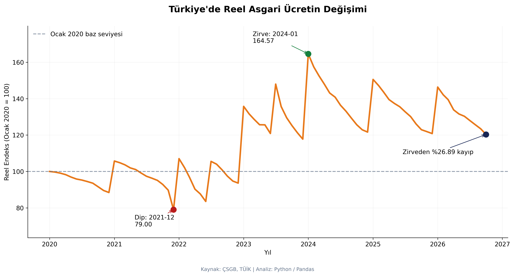
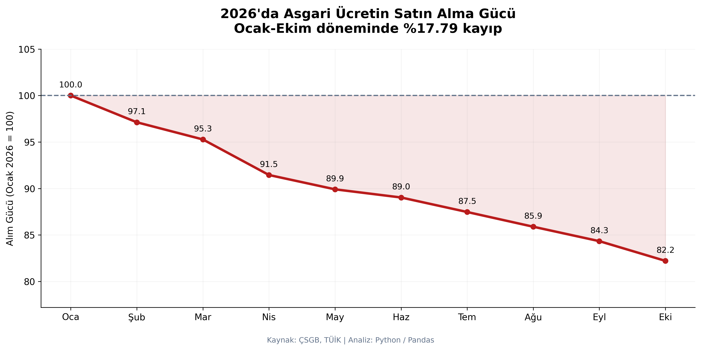

# Proje 02 — Türkiye'de Asgari Ücret ve Satın Alma Gücü

1 Hafta, 1 Veri Hikâyesi serisinin ikinci projesi.

## Araştırma Sorusu

Asgari ücretteki nominal artışlar satın alma gücüne ne ölçüde yansıyor ve ücret artışlarının etkisi zaman içerisinde nasıl değişiyor?

## Veri Setleri

- Çalışma ve Sosyal Güvenlik Bakanlığı (ÇSGB) — Net asgari ücret verileri
- Türkiye İstatistik Kurumu (TÜİK) — Tüketici Fiyat Endeksi (TÜFE)

Analiz dönemi: Ocak 2020 – Ekim 2026

Gözlem sayısı: 82 ay

Ücret dönemi sayısı: 9

## Analiz Yöntemi

- Veri temizleme ve veri kalitesi kontrolleri
- Ücret verilerinin aylık TÜFE verileriyle eşleştirilmesi
- Ocak 2020 = 100 olacak şekilde endeks normalizasyonu
- Reel ücret hesaplamaları
- Yıllık ve dönemsel değişim analizleri
- Veri görselleştirme

## Temel Bulgular

| Gösterge | Sonuç |
|---|---:|
| Nominal ücret artışı | +%1.107,70 |
| Kümülatif enflasyon | %903,70 |
| Reel ücret artışı | +%20,32 |
| Ocak 2024 zirvesinden reel değişim | −%26,89 |
| Son 12 aylık reel değişim | −%2,12 |
| 2026 Ocak–Ekim satın alma gücü değişimi | −%17,79 |

İncelenen dokuz ücret döneminin tamamında ilk ve son aylar arasında satın alma gücü kaybı gözlemlenmiştir.

## Reel Asgari Ücret

## 2026 Yılında Satın Alma Gücü

## Kullanılan Teknolojiler

- Python
- Pandas
- Matplotlib
- Openpyxl
- Jupyter Notebook

## Sınırlılıklar

Analiz genel TÜFE endeksine dayanmaktadır. Bireysel tüketim alışkanlıkları ve bölgesel fiyat farklılıkları dikkate alınmamıştır. Ücret dönemlerinin uzunlukları farklıdır. 2026 yılı yalnızca Ocak–Ekim dönemini kapsamaktadır.

## Veri Kaynakları

- https://www.csgb.gov.tr/
- https://veriportali.tuik.gov.tr/

Bu çalışma açık veri kullanılarak eğitim ve araştırma amacıyla hazırlanmıştır.
